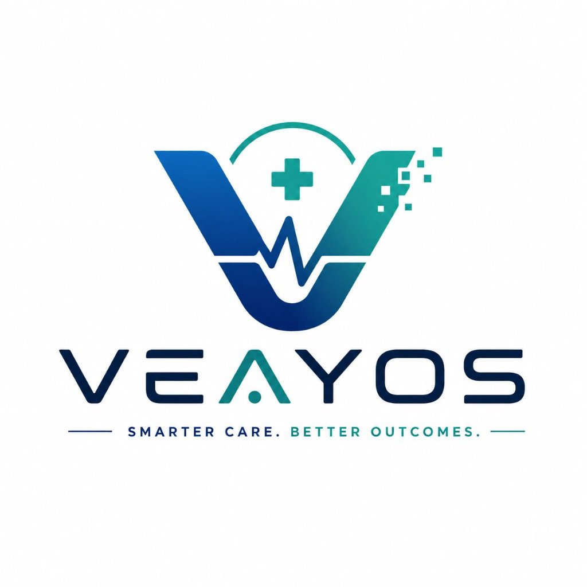

# VEAYOS Homoeopathy ClinicalOS (Full-Stack PWA & REST API)

<div align="center">
  
  <h3>Production-Grade Homoeopathy Clinical Practice OS & Classical Repertory Engine</h3>
  <p>Dedicated Node.js REST API Backend + Vite React Progressive Web App (PWA)</p>
</div>

---

## 🌟 Key Architecture & Highlights

1. **Official VEAYOS Company Logo Branding**:
   - High-resolution company emblem integrated across Navbar, Collapsible Sidebar, Doctor Login Modal, and Digital Letterhead Prescriptions.
   - PWA launcher icons generated in `192x192`, `512x512`, and crisp `favicon.png`.

2. **Dedicated Production-Ready Node.js Backend (`backend/`)**:
   - **Strict 2-Account Whitelist**:
     - `Dr. V. P. Dixit` (`vpdixit75@gmail.com`)
     - `Dr. Ved Prakash` (`ved@veayos.com`)
     - Non-whitelisted accounts are strictly rejected with HTTP `403 Forbidden`.
   - **Google Sign-In API (`/api/v1/auth/google`)**:
     - Supports Google credential & email validation with JWT session tokens (`HS256`, 7-day expiry).
     - Token re-verification (`/api/v1/auth/verify`) and user profile route (`/api/v1/auth/me`).
   - **Secure Server-Side Gemini AI Repertory Proxy (`/api/v1/repertory/analyze`)**:
     - Keeps Google Gemini API keys securely on the server side without browser exposure.
     - Automatically falls back to internal **Classical Kentian Repertory Engine** with weighted rubric scoring, grades (1 to 3), and Materia Medica keynotes.
   - **Complete Clinical REST Endpoints**:
     - Patients (`/api/v1/patients`)
     - Live Queue (`/api/v1/queue`)
     - Prescriptions (`/api/v1/prescriptions`)
     - Diagnostic Lab Tests (`/api/v1/tests`)
     - Medicine Presets (`/api/v1/medicines`)
     - Clinic & Letterpad Settings (`/api/v1/settings`)
     - Aisensy WhatsApp Dispatch (`/api/v1/whatsapp/send`, `/api/v1/whatsapp/test`, `/api/v1/whatsapp/logs`) with strict patient consent validation.

3. **Frontend PWA Client (`src/`)**:
   - Vite dev server with reverse proxy (`/api` -> `http://localhost:5000`).
   - Centralized `apiService.js` client layer.
   - Offline-capable with Firebase Cloud Firestore sync and localStorage resilience.
   - Top 8.0 cm (80mm) blank reservation strictly honored for clinic letterpad printing.

---

## 🚀 Quick Start Guide

### 1. Install Dependencies
```bash
# Frontend dependencies
npm install

# Backend dependencies
cd backend && npm install && cd ..
```

### 2. Configure Environment Variables
```bash
# Frontend Firebase config (Optional for Cloud Firestore sync)
cp .env.example .env

# Backend configuration (Gemini & Aisensy keys)
cp backend/.env.example backend/.env
```

### 3. Run Development Servers
```bash
# Run both Frontend PWA (port 5173) and Backend API (port 5000) concurrently:
npm run dev:all

# Or run separately:
npm run dev          # Frontend only: http://localhost:5173
npm run dev:backend  # Backend only: http://localhost:5000
```

### 4. Build for Production
```bash
npm run build
```

### 5. Automated Verification Suites
```bash
# Runs both Frontend deep test suite & Backend API test suite:
npm test

# Run individually:
npm run test:frontend # 10 frontend verification suites
npm run test:backend  # 24 backend API tests across 9 test suites
```

---

## 📡 REST API Reference

| Method | Endpoint | Description | Whitelist Enforced |
|---|---|---|:---:|
| `GET` | `/api/health` | Service health & metadata | Public |
| `GET` | `/api/v1/auth/whitelist` | List authorized practitioner profiles | Public |
| `POST` | `/api/v1/auth/google` | Google sign-in & JWT token issue | **Strict 2-Account** |
| `POST` | `/api/v1/auth/login` | Email sign-in & JWT token issue | **Strict 2-Account** |
| `POST` | `/api/v1/auth/verify` | Verify active session token | Yes |
| `GET` | `/api/v1/auth/me` | Authenticated practitioner details | Yes |
| `POST` | `/api/v1/repertory/analyze` | Gemini AI + Kentian Repertory Proxy | Yes |
| `GET` / `POST` | `/api/v1/patients` | Patient directory CRUD | Yes |
| `GET` / `POST` | `/api/v1/queue` | Live token queue & consult status | Yes |
| `GET` / `POST` | `/api/v1/prescriptions` | Homoeopathy prescriptions | Yes |
| `GET` / `POST` | `/api/v1/tests` | Lab and diagnostic reports | Yes |
| `GET` / `POST` | `/api/v1/medicines` | Remedies & Materia Medica library | Yes |
| `GET` / `PUT` | `/api/v1/settings` | Clinic profile & Aisensy gateway | Yes |
| `POST` | `/api/v1/whatsapp/send` | Aisensy WhatsApp message dispatch | Yes (Patient Consent) |
| `POST` | `/api/v1/whatsapp/test` | Test Aisensy WhatsApp connection | Yes |

---

## 🔒 Security & Whitelist Compliance

Access is strictly restricted to authorized clinic practitioners:
1. `vpdixit75@gmail.com` — **Dr. V. P. Dixit**, Senior Homoeopath & Medical Director
2. `ved@veayos.com` — **Dr. Ved Prakash**, Consultant Homoeopath & Operations Lead

Any attempt to log in or obtain session tokens using any other email or Google ID returns `HTTP 403 Forbidden: Access Denied`.

---

## 📦 Push to GitHub

The repository is fully configured with clean git tracking and proper `.gitignore` (secrets and node_modules excluded).

To push to GitHub:
```bash
# Create repository via GitHub CLI (already authenticated):
gh repo create veayos-clinicalos --public --source=. --remote=origin --push

# Or push to an existing GitHub remote repository:
git remote add origin https://github.com/<your-username>/<repo-name>.git
git push -u origin main
```
